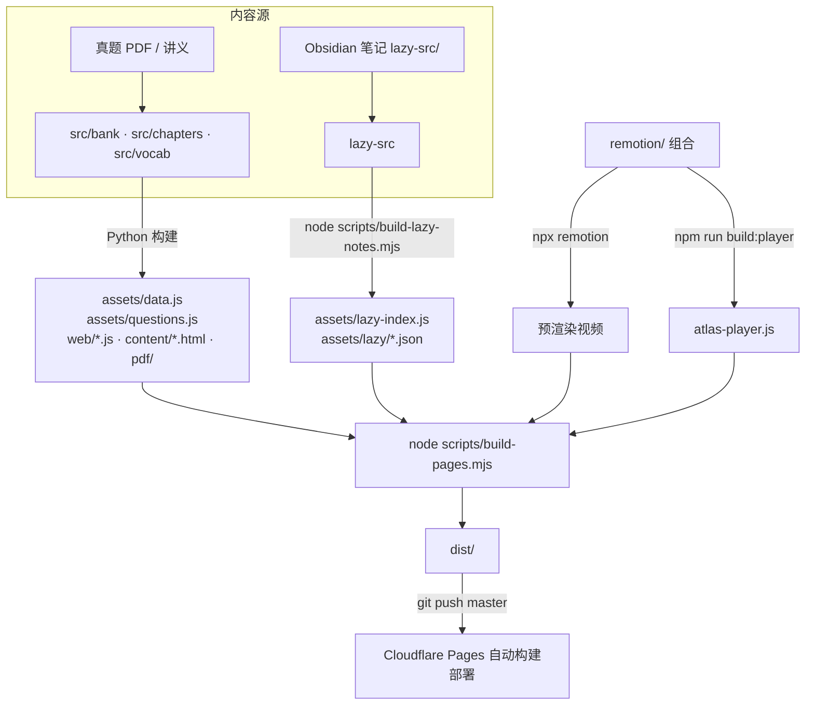

# 考研科目大观 · KAOYAN ATLAS

面向 2027 考研的个人备考站：把「科目 → 章节 → 考点 → 真题 → 专题」组织成一张可点击的知识图谱，配合题库、笔记库、词汇与时间轴，全部需要登录后使用。

- 线上：<https://kaoyan-atlas-pages.pages.dev>
- 仓库：`GGbond-god5/kaoyan-atlas-pages`（唯一开发源）
- 目标院校示例：华南理工大学 085500 机械（数学一 / 英语一 / 807 材料力学 / 政治）

---

## 一、功能与使用

### 页面一览

| 页面 | 文件 | 能做什么 |
| --- | --- | --- |
| 图谱首页 | `index.html` | 四个科目节点展开成章节与考点；点击章节或考点在页内阅读讲义，可下载 PDF；按档案过滤科目；顶部有搜索（`/`）、目录、档案、笔记库入口 |
| 刷题 | `practice.html` | 三种模式：按知识点、按套卷、能力自测；答题卡、计时、交卷后逐题自动评分、能力雷达图、AI 作文评分与教练问答 |
| 词汇 | `vocab.html` | 5529 个大纲词按专题分组，自测与生词本 |
| 时间轴 | `timeline.html` | 1840—2026 政治史纲时间线，节点可跳到对应考点 |
| 资料库 | `library.html` | 上传 PDF / 图片 / 文本，按页抽取题目（AI），审阅后导入个人题库 |
| 题库索引 | `bank.html` | 按来源浏览全部 5530 道题与 34 套真题原卷 |
| 登录 / 注册 | `login.html` / `register.html` | 手机号 + 短信验证码注册登录，也支持密码登录；注册后弹出新用户引导 |

### 典型使用流程

1. **先建档**：首页「档案」填目标院校、专业、初试日期、考试科目。不考数学可取消；专业课可加自定义项（显示占位章节，引导去资料库）。
2. **读图**：点科目展开章节，点章节在页内读讲义（KaTeX 公式、双链跳转、图片、PDF）。
3. **刷题**：选知识点 / 套卷 → 交卷 → 自动评分与解析 → 错题进能力图。
4. **记笔记**：章节上的「笔记 N」徽标打开内置笔记库；右上「新建笔记」写自己的笔记，支持图片与附件。
5. **查资料**：资料库上传讲义或真题，AI 抽题后人工审阅再入库。

---

## 二、技术栈与架构

### 技术选型

| 层 | 选型 | 说明 |
| --- | --- | --- |
| 前端 | 原生 HTML / CSS / JS | 无框架、无打包步骤（Remotion 播放器除外） |
| 后端 | Cloudflare Pages Functions | `functions/` 目录即路由，Workers 运行时 |
| 数据库 | Cloudflare D1（SQLite） | 账号、档案、笔记、学习平台数据 |
| 文件存储 | Cloudflare R2 | 资料上传与讲义附件，绑定 `LIBRARY_FILES` |
| 短信 | 阿里云号码认证服务 | 本地可用 `SMS_DEV_CODE=1` 走 mock |
| AI | 千问平台 OpenAI 兼容接口（`qwen3-vl-plus`） | 抽题、作文评分、教练问答 |
| 动效 | Remotion 4 | 首页用 `@remotion/player` 内嵌，登录页用预渲染视频 |

### 请求链路

```mermaid
flowchart LR
  U[浏览器] --> M[Pages Functions<br/>_middleware.js 登录门禁]
  M -->|未登录| L[/login]
  M -->|已登录| S[静态资源 / 页面]
  M --> A[业务接口 /api/*]
  A --> D1[(D1 数据库)]
  A --> R2[(R2 文件)]
  A --> Q[千问 AI]
  A --> SMS[阿里云短信]
```

### 登录门禁

`functions/_middleware.js` 拦截全站：未登录访问页面 302 到 `/login?next=…`，访问静态资源与接口返回 401。白名单只有登录/注册页、`auth.*`、`config.js`、`transitions.css`、`/assets/remotion/`、`/api/auth/*`、`/api/sms/send`、`/api/health`。

### 账号安全

- 密码：PBKDF2-SHA256，默认 20000 次迭代（`PBKDF2_ITERATIONS` 可调；免费版 Functions 单请求 CPU 约 10ms，别调太高）
- 会话：HMAC-SHA256 签名的 HttpOnly Cookie，有效期由 `SESSION_DAYS` 控制
- 短信：60 秒重发、每日限额、错误锁定

---

## 三、全栈工作流



### 两种构建不要混淆

| 构建 | 命令 | 何时跑 | 产物 |
| --- | --- | --- | --- |
| 内容构建（Python） | `py -3 src/build/*.py` | 改题库、讲义、词汇后**本地**跑 | `assets/*.js`、`web/*.js`、`content/*.html` |
| 页面构建（Node） | `node scripts/build-pages.mjs` | 部署前，**Cloudflare 也会跑** | `dist/` |

> Pages 构建只复制文件、不运行 Python，所以 Python 生成物必须和源文件一起提交。

---

## 四、目录地图

```
index.html practice.html vocab.html timeline.html library.html bank.html login.html register.html
assets/          前端脚本、样式、生成的数据（data.js / questions.js / lazy-*）
  remotion/      预渲染视频与 Remotion 播放器 bundle
content/         讲义 HTML（58 篇）
pdf/             讲义 PDF
web/             学科总览等生成页面
functions/       Pages Functions：api/ 路由 + _lib/ 公共模块 + _middleware.js
src/             内容源与 Python 构建脚本（bank/ 为本地题库，不入库）
lazy-src/        Obsidian 笔记源：数一 / 英一 / 政治
scripts/         Node 构建脚本（页面、笔记转换、抽题提示词）
remotion/        Remotion 工程（AtlasField 视频、AtlasVeil 交互背景）
tests/           结构校验与浏览器端测试
docs/            部署、制作、协作、审计等文档
wrangler.toml    D1 / R2 绑定与变量
_headers         静态资源缓存策略
```

---

## 五、接口

| 方法 | 路径 | 作用 |
| --- | --- | --- |
| POST | `/api/auth/register` | 手机号 + 验证码注册 |
| POST | `/api/auth/login` | 验证码或密码登录 |
| POST | `/api/auth/logout` | 退出 |
| GET | `/api/auth/me` | 当前用户 |
| POST | `/api/sms/send` | 发送验证码（mock 模式可回传 devCode） |
| GET/PUT | `/api/profile` | 个人档案 |
| GET | `/api/programs` | 院校专业目录搜索 |
| GET/POST | `/api/notes` | 个人笔记列表 / 新建 |
| GET/PUT/DELETE | `/api/notes/:id` | 单篇笔记 |
| POST | `/api/notes/upload` | 附件上传（R2） |
| GET | `/api/notes/file/:file` | 附件读取（校验归属） |
| GET/POST | `/api/library` | 资料列表 / 上传 |
| POST | `/api/library/:id/extract` | 按页 AI 抽题 |
| POST | `/api/library/:id/import` | 审阅后导入个人题库 |
| 任意 | `/api/personal/questions` | 个人题库 |
| 任意 | `/api/attempts` · `/api/attempts/:id/grade` | 答题记录 / 评分 |
| POST | `/api/grade` | 作文 AI 评分 |
| 任意 | `/api/coach` | AI 教练问答 |
| 任意 | `/api/state/:namespace` | 前端状态同步 |
| POST | `/api/feedback` | 意见反馈：存 D1，配置 `RESEND_API_KEY` 后直接发到站主邮箱 |
| GET | `/api/health` | 健康检查（D1 / R2 / 密钥 / AI） |

### 数据库表

账号：`users`、`sms_send`、`codes`、`login_fail`
档案与笔记：`user_profiles`、`user_notes`
学习平台：`platform_files`、`platform_drafts`、`platform_extractions`、`platform_questions`、`platform_state`、`platform_attempts`、`platform_results`、`platform_coach`

`platform_*` 系列由接口在首次调用时自动建表，无需手工迁移。

---

## 六、动效（Remotion）

- **首页**：组合 `AtlasVeil` 通过 `@remotion/player` 跑在浏览器里，节点会随指针排斥、指针处亮起暖光。改完 `remotion/src/` 必须重建：
  `cd remotion && npm run build:player` → 产物 `assets/remotion/atlas-player.js`
- **登录页**：预渲染视频 `assets/remotion/atlas-field.mp4`（组合 `AtlasField`，1600×900、6 秒循环）
  重新渲染：`cd remotion && npx remotion render AtlasField ../assets/remotion/atlas-field.mp4 --codec=h264`
- **跨页过渡**：`assets/transitions.css`，支持 View Transitions 的浏览器走原生导航过渡，其余淡入
- 动效默认开启；地址后加 `?motion=0` 可整体关闭（播放器、视频、过渡一起停）
- 动效只出现在首页与登录页，其余页面保持朴素

---

## 七、本地开发

需要 Node 18+、Python 3（内容构建）、Cloudflare 账号（可选）。

```bash
git pull --rebase origin master
git switch -c claude/<主题>

npx wrangler pages dev . --d1=DB --r2=LIBRARY_FILES \
  --binding SESSION_SECRET=local-dev-secret \
  --binding SMS_DEV_CODE=1
```

打开 `http://127.0.0.1:8788`。本地 D1/R2 数据在 `.wrangler/`，不会污染线上；`SMS_DEV_CODE=1` 时短信接口会回传验证码，方便注册测试账号。

改内容后自检：`node scripts/build-pages.mjs`。

---

## 八、部署

1. 提交并推送 `master` → Cloudflare Pages 自动执行 `node scripts/build-pages.mjs` 并发布 `dist/`
2. 生产环境变量只在 Cloudflare 控制台维护：`SESSION_SECRET`、`ALIYUN_ACCESS_KEY_ID`、`ALIYUN_ACCESS_KEY_SECRET`、`ALIYUN_SMS_SIGN_NAME`、`ALIYUN_SMS_LOGIN_TEMPLATE_CODE`；AI 用 `AI_BASE_URL`/`AI_API_KEY`/`AI_MODEL`（需支持识图）；可选 `SMTP_USER`/`SMTP_PASS`（意见反馈直发）、`RESEND_API_KEY`、`FEEDBACK_TO`
3. **不要**用 `wrangler pages deploy` 直传，也不要改控制台里的项目设置

上线前至少确认：未登录访问 `/` 跳登录、受保护资源 401、`/api/health` 各项为 true、套卷交卷能跑完自动评分、笔记与档案正常。

### AI 接入

所有 AI 调用都走 `functions/_lib/platform.js` 的 `ai()`，共用一个 OpenAI 兼容的 `/chat/completions` 端点：文字（教练问答、作文评分）和图片（拍照批改、PDF 按页抽题）不分开，因此所选模型必须**同时支持识图和 JSON 输出**。

| 环境变量 | 说明 |
| --- | --- |
| `AI_BASE_URL` | 接口地址，默认 `https://dashscope.aliyuncs.com/compatible-mode/v1` |
| `AI_API_KEY` | 密钥（旧部署的 `DASHSCOPE_API_KEY` 仍然兼容） |
| `AI_MODEL` | 模型名，默认 `qwen3-vl-plus` |
| `AI_MAX_TOKENS` | 单次输出上限，默认 3000；推理型模型建议调到 6000 以上 |
| `AI_REASONING_EFFORT` | 可选，推理型模型传 `low`/`high`/`max`；不填则不下发该参数 |

推理型模型（如 DeepSeek V4）会把 token 先花在思考上，`max_tokens` 偏小时 `content` 会是空的，表现为「AI 返回为空」。遇到就把 `AI_MAX_TOKENS` 调大，并把 `AI_REASONING_EFFORT` 设成 `low`。

### 意见反馈发信

页面右上「意见反馈」点「发送」会 POST 到 `/api/feedback`：内容始终写入 D1 表 `feedback`，然后按下面的优先级发信。

1. **SMTP（首选，和 KPL BP 模拟器同一套做法）**：配置 `SMTP_USER` + `SMTP_PASS` 后，`functions/_lib/smtp.js` 会用隐式 TLS 连 `smtp.163.com:465`，`AUTH LOGIN` 认证后直接寄到 `FEEDBACK_TO`。`SMTP_PASS` 填网易邮箱的 **SMTP 授权码**（163 网页版 → 设置 → POP3/SMTP/IMAP → 开启 SMTP 服务后生成），不是登录密码
2. **HTTP 发信服务**：没配 SMTP 时，若设置了 `RESEND_API_KEY` 就走 Resend
3. 两者都没有：只存库，弹窗提示「内容已留存」

一次性配置：

1. Cloudflare Pages 项目 → Settings → Environment variables
2. 添加 `SMTP_USER`（邮箱地址）与 `SMTP_PASS`（授权码），类型都选密文；可选 `SMTP_HOST`、`SMTP_PORT`、`SMTP_FROM`、`FEEDBACK_TO`
3. 等下次部署生效

`/api/health` 的 `bindings.SMTP` 可以确认是否生效。发信失败时内容也不会丢，仍留在 `feedback` 表里。`/api/feedback` 每小时每 IP 限 5 条。

---

## 九、测试

| 测试 | 覆盖 |
| --- | --- |
| `tests/*.mjs` | 浏览器端流程（Playwright）：认证界面、能力自测、新用户引导、平台接口、词汇、用户状态 |
| `tests/*.py` | 题库结构校验（英语二各年份） |
| `src/build/katex_check.js` | 公式写法检查 |

所有 `tests/*.mjs` 都需要本机安装 Playwright 与 Edge/Chromium；涉及账号的用例要对着本地 Pages（`SMS_DEV_CODE=1`）跑。结构校验类是 `tests/*.py` 与 `src/build/katex_check.js`。

---

## 十、已知限制

- 免费版 Functions 单次 CPU 约 10ms：PBKDF2 迭代不能调高，重计算要放前端
- 单文件 ≤ 25 MiB，部署文件数 ≤ 20,000（当前约 2,100）
- 题库仍有缺口：政治 864 题缺答案与解析，英语一 108 题缺答案、47 题缺解析，英语二 316 题缺答案、336 题缺解析；材料力学 193 题缺逐题来源核查
- 政治笔记 687 篇来自 [XColorful/Politics-Obsidian-Note](https://github.com/XColorful/Politics-Obsidian-Note)，**CC BY-SA 4.0**，笔记库中保留了署名，转载时不要删除
- 登记前记录的旧 R2 测试对象与旧 D1 库 `kaoyan-atlas-auth` 不要复用

---

## 十一、相关文档

| 文档 | 内容 |
| --- | --- |
| `AGENTS.md` | 多代理协作约定、目录分工、禁区 |
| `docs/制作过程.md` | 内容构建脚本与流程 |
| `docs/Cloudflare部署指南.md` | 部署细节与排错 |
| `docs/Codex协同指南.md` | 多代理协作细则 |
| `docs/真题入库指南.md` | 真题录入规范 |
| `docs/开发交接-2026-11-14.md` | 某次交接时的完整状态快照 |
| `docs/audit/` | 题库核校记录 |
| `docs/ds-free-api部署.md` | 把免费文本 AI 网关接到本站的完整步骤 |
